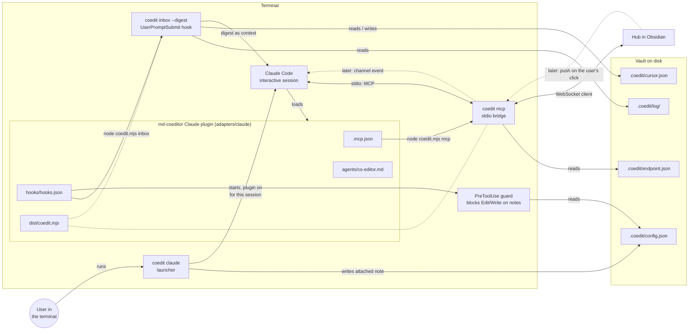
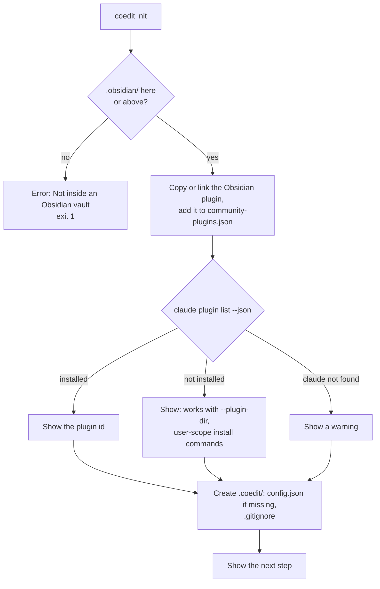
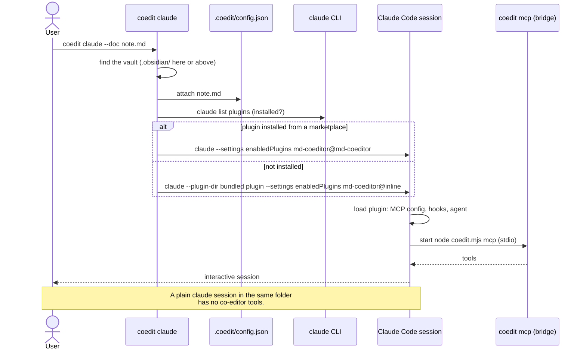
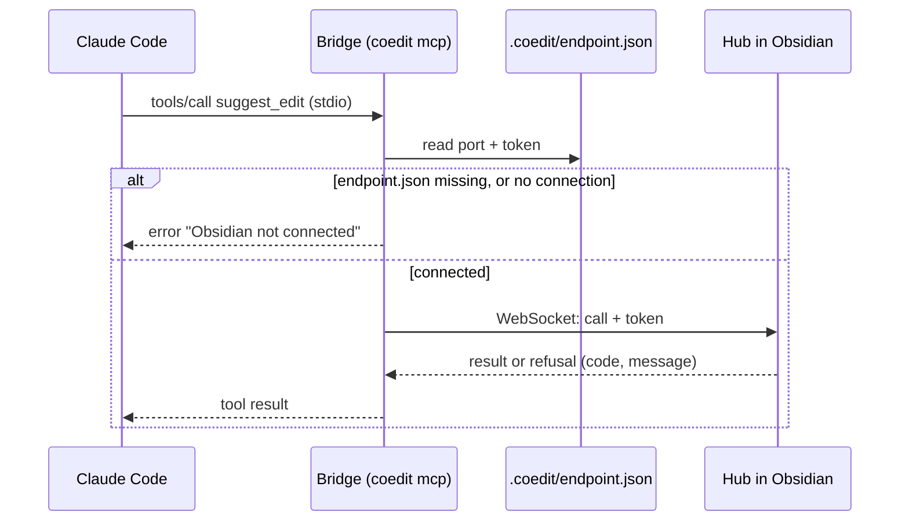
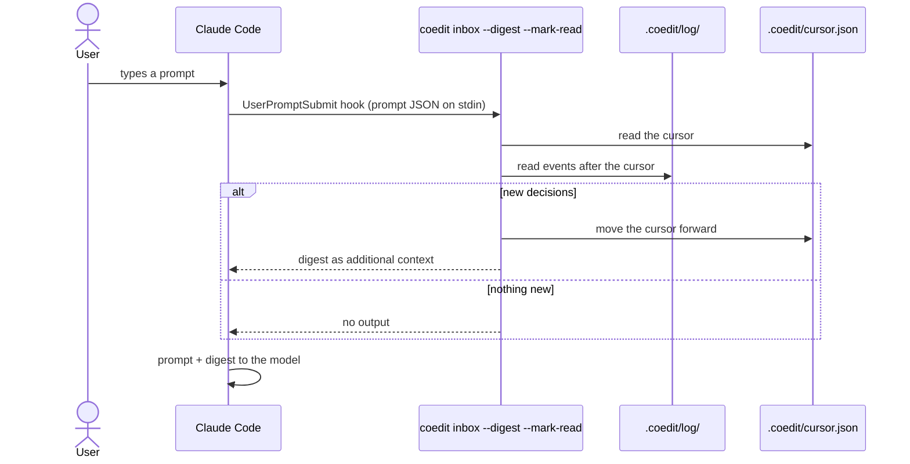
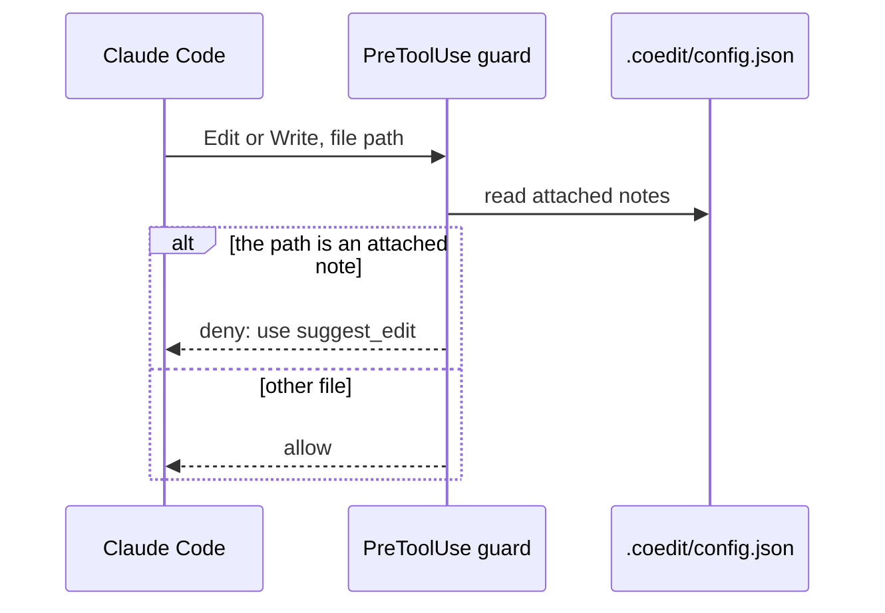

# MD-Coeditor architecture: Claude side

> **Note (2026-10-25):** This file still shows the plan before change 3 (`add-claude-suggest-loop`). Change 3 drops note attachment and the guard, uses one event log for each machine, a folder for each machine (`.coedit/local/<machine>/`) and a cursor for each session. Until task 11.2 of that change updates this file, its [design.md](../changes/add-claude-suggest-loop/design.md) wins on conflict.

Part of the architecture. The entry point is [architecture.md](architecture.md). The Obsidian side is in [architecture-obsidian.md](architecture-obsidian.md), the mark format in [architecture-format.md](architecture-format.md). The plugin file layout, the load commands and the corporate settings are in [tech-stack.md](tech-stack.md#claude-code-plugin).

The Claude side has two parts:

- **The `coedit` binary** (`packages/bridge`): one Node file with the subcommands `init`, `claude`, `mcp` and `inbox`.
- **The Claude plugin** (`adapters/claude`): the MCP config, the hooks, the agent definition and its own copy of `coedit.mjs`.

Status: the binary has its subcommand registry (change 1). The subcommands and the plugin content are planned for change 3 (`add-claude-suggest-loop`). Push (change 4) is dashed.

## Component diagram

## The `coedit` binary

| Subcommand | Who runs it | What it does |
|---|---|---|
| `coedit init` | You, one time for each vault | Prepares a vault (see below). |
| `coedit claude [--doc note.md]` | You, or the Obsidian command "Start co-editor" | Finds the vault and the Claude plugin. Attaches the note. Starts `claude` with the plugin switched on for this session only. |
| `coedit inbox --digest --mark-read` | The `UserPromptSubmit` hook | Reads the log from disk, makes the digest, moves the cursor. Works when Obsidian is closed. |
| `coedit mcp` | Claude Code | The bridge. Offers the MCP tools over stdio and sends each call to the hub. |

CLI rules:

- **Exit codes.** 0 success, 1 runtime error, 2 usage error.
- **Subcommand registry.** Each subcommand has a name, a one-line description and a handler. The help text is made from the registry. A new subcommand is a new registry entry.
- **Testable entry.** `src/cli.ts` only calls `run(argv, io)`. `io` contains `stdout`, `stderr` and the version, so tests can pass fakes.
- **Node only.** The plugin and the tests start `coedit.mjs` with `node`, not through the shebang or the PATH (see [tech-stack.md](tech-stack.md#macos-and-windows)).

### `coedit init`

Run it inside a vault. It is idempotent: a second run updates the plugin files and changes nothing else. Other commands also work without `init`. They create missing folders themselves.

1. **Find the vault.** Look for `.obsidian/` in the current folder and in the folders above it. If there is none, stop with the error "Not inside an Obsidian vault".
2. **Install the Obsidian plugin.** If `.obsidian/plugins/md-coeditor/` is missing or older, copy the plugin files. With `--dev`, make a link to `packages/obsidian/dist` (a symlink on macOS and Linux, a directory junction on Windows). Add `md-coeditor` to `.obsidian/community-plugins.json`. If Obsidian is open, show: "Reload Obsidian. If the plugin is off, switch it on in Settings → Community plugins." Obsidian can overwrite this file while it runs.
3. **Check the Claude plugin.** Run `claude plugin list --json`.
   - Installed: show its id.
   - Not installed: show that `coedit claude` works without it (`--plugin-dir`). Show the commands to install it at user scope. Do not install it automatically. In a company, that is the user's decision.
   - Do not suggest project scope. Then every `claude` session in the vault loads the plugin.
   - `claude` not found: show a warning.
4. **Create `.coedit/`.** Write `config.json` with defaults, only if it is missing. Write `.coedit/.gitignore`.
5. **Show the next step.** For example: "Reload Obsidian, then run `coedit claude`."

`init` does not change notes, and does not change the vault's own `.gitignore`.

## Session start

`coedit claude` switches on the plugin for this session only. The plugin has `defaultEnabled: false`, and `--settings` has the scope "this session". The exact commands for a marketplace install and for `--plugin-dir` are in [tech-stack.md](tech-stack.md#how-a-session-loads-the-plugin).

## A tool call

The bridge is thin in slice 1. It finds the hub, adds the token, and passes the call and the answer through.

The hub side of this call is in [architecture-obsidian.md](architecture-obsidian.md#a-suggestion-from-the-agent).

## Digest

The agent learns about the user's decisions at the next prompt. The `UserPromptSubmit` hook runs `coedit inbox --digest --mark-read`. It reads the log from disk, so it does not need the hub, and it works when Obsidian is closed. The cursor in `cursor.json` records what the agent has seen.

## Guard

A `PreToolUse` hook blocks the built-in Edit and Write tools on attached notes. So the agent changes these notes only through `suggest_edit`, and every change becomes a mark.

## Push (later)

Change 4 (`add-agent-push`) adds push on the user's click in Obsidian, through a Claude channel. The hub sends a message to the bridge, and the bridge sends a channel event into the session. Spike S2 checks which channel flag value works for each load method (see [tech-stack.md](tech-stack.md#checks-for-the-spikes)).
