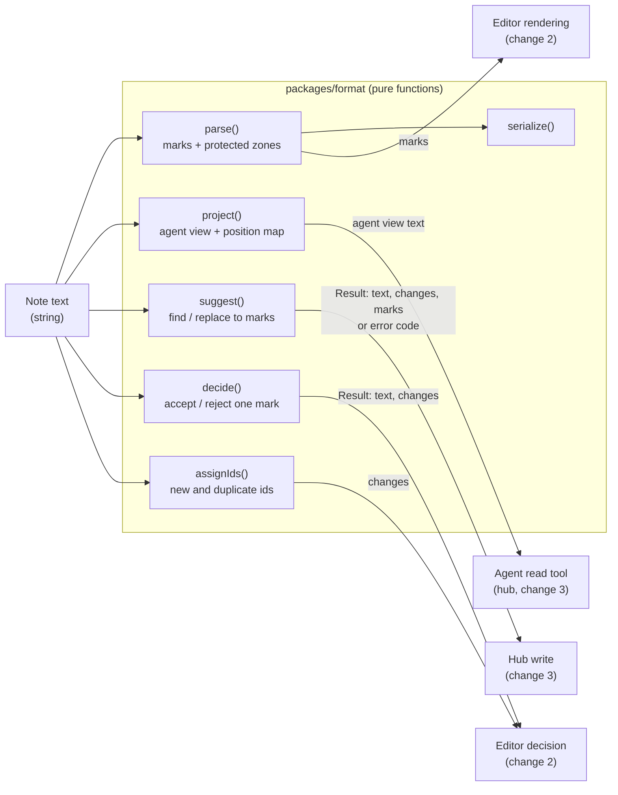
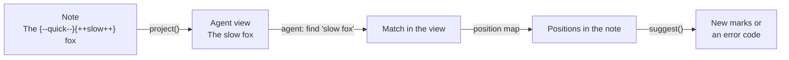
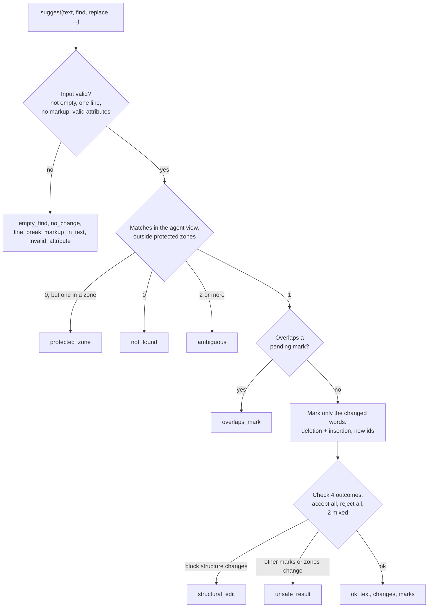

# MD-Coeditor architecture: mark format

> **Note (2026-10-25):** This file still shows the plan before change 3 (`add-claude-suggest-loop`). Change 3 adds the zone kinds `wikilink` and `callout-marker`, the CommonMark rule for backslashes in inline code, and refusal details. Until task 11.2 of that change updates this file, its [design.md](../changes/add-claude-suggest-loop/design.md) wins on conflict.

Part of the architecture. The entry point is [architecture.md](architecture.md). The Obsidian side is in [architecture-obsidian.md](architecture-obsidian.md), the Claude side in [architecture-claude.md](architecture-claude.md).

`packages/format` owns the mark format. Every other part (plugin, hub, bridge) uses it and does not parse marks itself. Users commit notes in this format, so later changes must stay compatible with it. The details are in the specs `markup-format` and `change-decisions`.

## Data flow

All functions take the note text and give back data. The callers apply the returned `changes`.

## Dialect

The dialect is the obsidian-track-changes format. We checked it against the other Obsidian CriticMarkup plugins on 2026-10-24.

- The five CriticMarkup kinds: `{++insertion++}`, `{--deletion--}`, `{~~old~>new~~}`, `{==highlight==}`, `{>>comment<<}`.
- An optional attribute prefix inside the braces: `{id="k3f9qz" author="Claude" date="2026-10-24"++new++}`. New marks write `id`, `author`, `date` in this order. Unknown attributes are kept, in their order. This is the extension point for later attributes.
- Attribute rules: spaces or tabs separate the attributes. A value has no `"`, `{`, `}` or line break. A `date` is a real calendar date.
- Compatibility: the obsidian-track-changes plugin reads our marks, with author and date. The plugins review-comments, review-critics, Inkling and Commentator show our marks as plain text. They do not damage the note. Commentator writes its data as `{++{"author":"X"}@@x++}`. We read that data as content for now. A follow-up in `add-external-changes` fixes this (see [roadmap.md](roadmap.md#follow-ups-from-change-1)).
- A mark ends at the first close sequence of its kind. A mark can contain a single line break, but no blank line.
- Considered and rejected: the attributes in an HTML comment after the mark (`{++x++}<!--id="a1"-->`). Plain CriticMarkup tools would show a clean mark, but an edit can separate the comment from its mark. Only `attrs.ts`, `parse.ts` and `serialize.ts` know the prefix.

## Protected zones

Frontmatter (also after a byte order mark), fenced and indented code blocks, inline code, and tables. Marks are never recognized, created or decided inside them, and a mark never crosses a block zone. The zone rules are simple approximations of CommonMark, not a full parser. Known gaps (escaped backticks, `[[wikilinks]]`, callout markers) are roadmap follow-ups.

## Ids

Each mark that MD-Coeditor creates gets a random 6-character id (`[a-z0-9]`). Ids are not counters, because the event log keeps old ids after their marks leave the note. `assignIds` gives ids to marks without one and to duplicates (for example after copy and paste). It changes only the prefix.

## Rules for the format library

- **Pure functions.** Text in, data out. No I/O, no clock, no global state. No imports from Obsidian, CodeMirror, Node or the DOM, so it runs in Electron and in Node.
- **Lossless.** Parse never normalizes. Parse and serialize give back the same text, byte for byte (CRLF, non-ASCII, malformed marks).
- **Positions are UTF-16 code units**, the same as JavaScript string indices and CodeMirror positions. Nothing may split a surrogate pair (an emoji).
- **Writers report edits.** `suggest`, `decide` and `assignIds` return `changes` (`from`, `to`, `insert`, in positions of the input text) and the new text. The plugin applies `changes` as one CodeMirror transaction, so the cursor and the undo history survive.
- **Functions take text, not a parse result.** A caller cannot pass a stale parse.
- **Refusals are results, not exceptions.** Each has a code and a short English message that the hub can give to the agent as it is. Exceptions are only for programming errors.

## Agent view

The agent view is the note as if all pending marks were accepted: insertions, highlights and the new text of substitutions show; deletions and comments are hidden. `project()` makes it, with a map back to note positions.

- The agent reads notes in the agent view (the read tool in change 3), and `suggest` matches the find text in the same view. So matches fit what the agent saw.
- Matches that touch a pending mark count. If the agent sees the text two times, the result is `ambiguous`, never a silent choice. Matches in protected zones do not count.

## Suggestions are safe in every outcome

A suggestion becomes a deletion and an insertion, each with its own id and decision. Only the changed words are marked. Before `suggest` writes, it checks the marked text and every decision outcome (accept all, reject all, and both mixed outcomes):

- No other mark is lost, joined or added, and the protected zones stay the same. Else: `unsafe_result`.
- The block structure of the line stays the same: block prefix (heading, list, task and quote markers, indentation of 4 or more columns), setext underline, thematic break. Else: `structural_edit`.

So a decision in Obsidian can never break the note or hide other pending marks. Slice 1 suggestions are one line each, with no markup in the find or replace text.

