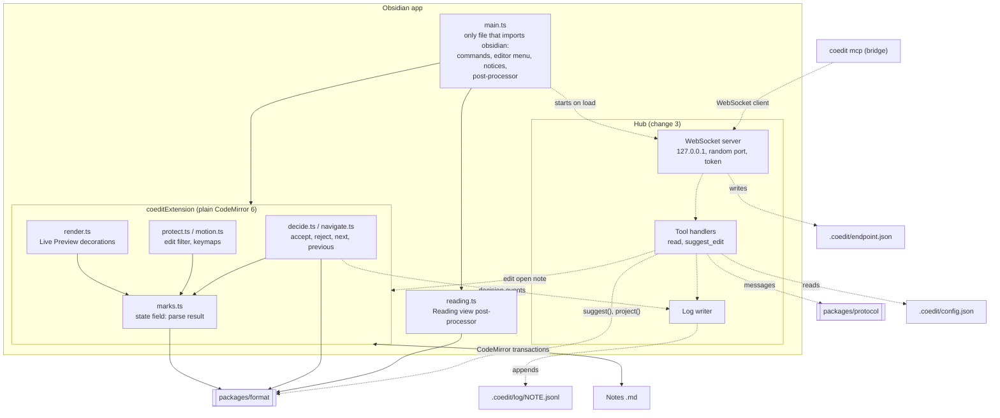
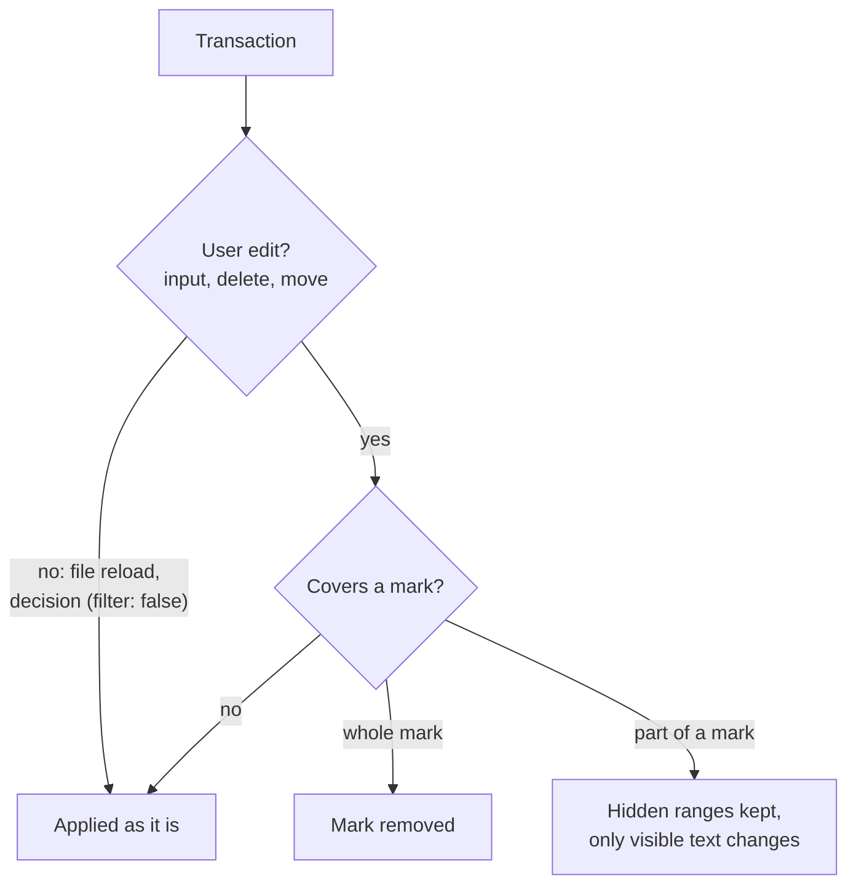
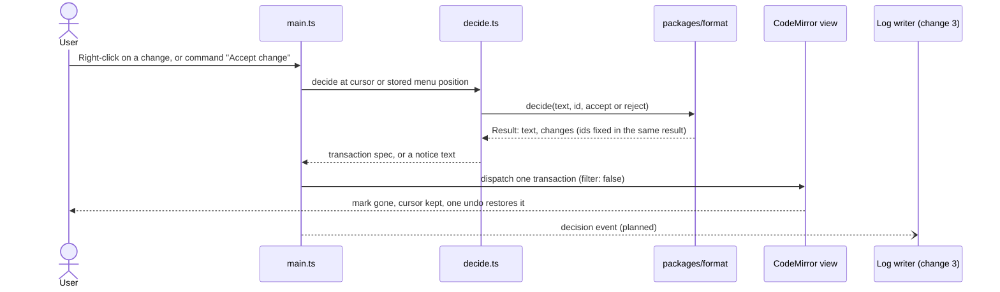
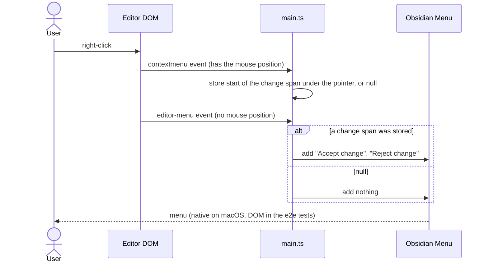
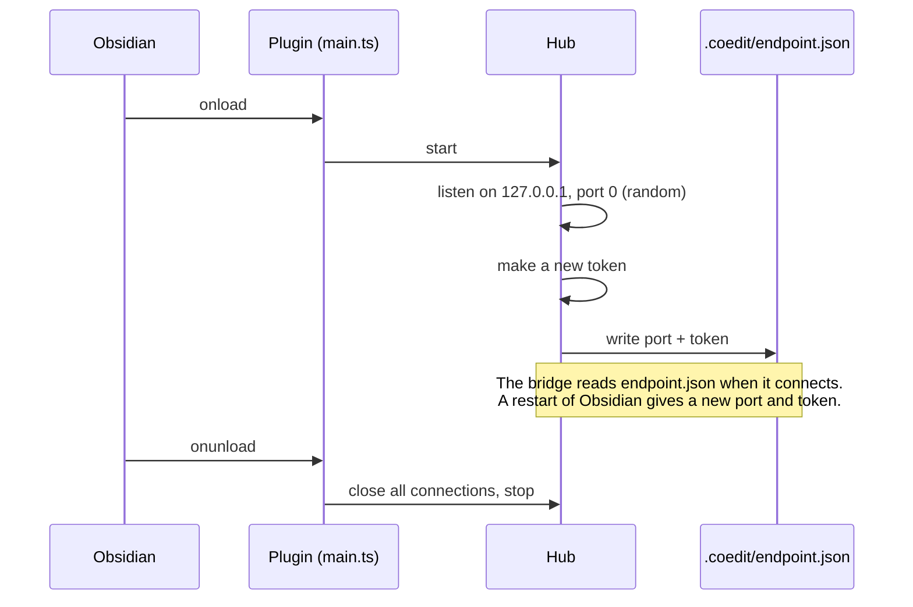
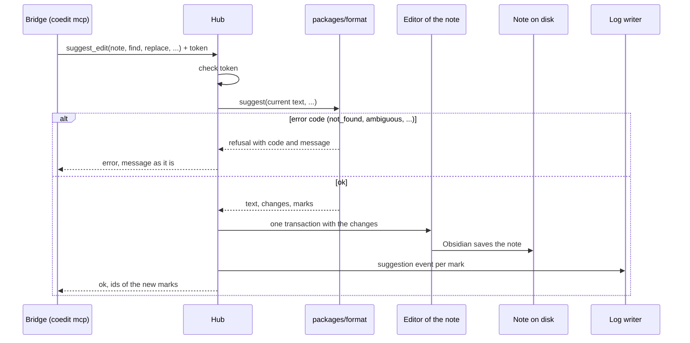

# MD-Coeditor architecture: Obsidian side

> **Note (2026-10-25):** This file still shows the plan before change 3 (`add-claude-suggest-loop`). Change 3 drops note attachment and the guard, uses one event log for each machine, a folder for each machine (`.coedit/local/<machine>/`) and a cursor for each session. Until task 11.2 of that change updates this file, its [design.md](../changes/add-claude-suggest-loop/design.md) wins on conflict.

Part of the architecture. The entry point is [architecture.md](architecture.md). The Claude side is in [architecture-claude.md](architecture-claude.md), the mark format in [architecture-format.md](architecture-format.md). Build and version rules for the plugin are in [tech-stack.md](tech-stack.md#obsidian-plugin).

The Obsidian plugin (`packages/obsidian`) has two parts:

- **Editor** (change 2, done): renders marks and lets the user accept and reject them.
- **Hub and log writer** (change 3, planned): the WebSocket server for the bridge, and the event log.

## Component diagram

Solid lines: done. Dashed lines: planned for change 3.

## Editor

From change 2 (`add-obsidian-review-basics`).

### Modules

All editor logic is plain CodeMirror 6 code in `packages/obsidian/src`, so it runs in jsdom tests. Only `main.ts` imports `obsidian`. It registers the extension, the commands, the editor menu and the Reading view post-processor, and it shows notices. It has no other logic.

| Module | Content |
|---|---|
| `marks.ts` | A state field with the parse result of the note (insertions, deletions, other kinds, duplicate ids). It parses the whole note on each document change. Also the injected `isLivePreview` check and the hidden ranges of a mark. |
| `render.ts` | Live Preview decorations: hidden syntax, the classes `coedit-ins` and `coedit-del` with an `aria-label` tooltip, atomic ranges. Nothing in Source mode. |
| `protect.ts`, `motion.ts` | Edit protection and cursor keys (see below). |
| `decide.ts`, `navigate.ts` | Accept and reject at the cursor or at the right-click position, next and previous change. Each returns a transaction spec or a notice text. |
| `reading.ts` | Reading view rendering. |
| `extension.ts` | All of the above as one extension: `coeditExtension({ isLivePreview })`. |

### Hidden syntax stays whole

- In Live Preview, the braces, operators and attributes of insertions and deletions are always hidden, also with the cursor inside. They are atomic ranges.
- A change filter applies to user edits only (`input`, `delete`, `move`). When an edit covers part of a mark, the filter keeps that mark's hidden ranges, so only the visible text changes. An edit that covers the whole mark removes it. File reloads and decisions are not user edits, so they pass.
- Keymaps (`Prec.high`) work on visible characters next to hidden syntax: Backspace and Delete delete the visible character on the other side, and Left and Right (also with Shift) move over one visible character with one key press. Without them, a key press at a mark edge does nothing that the user can see.
- A decision is one transaction with `filter: false`. A mark without an id, or with a duplicate id, gets a new id in the same transaction, so one undo gives back the exact text.

### Accept or reject a change

### Right-click menu

Obsidian's `editor-menu` event does not give the mouse position. A `contextmenu` handler stores the start of the change span under the pointer (null when the pointer is not on a change span), and `editor-menu` adds "Accept change" and "Reject change" only for that position. A click on plain text next to a mark does not show the items. On macOS the menu is native by default, so the DOM does not show it. The end-to-end tests set `nativeMenus: false` in the fixture vault: the menu is then a DOM `.menu` on all systems, and the tests right-click, read the item titles and click an item (change 12, design D4). The plugin adds its items to Obsidian's `Menu` object in both cases, so the plugin code path is the same. The native display is Obsidian's code; one manual look at it stays in the manual list ([testing.md](testing.md)).

### Reading view

The post-processor collects the text nodes of a rendered section (not in `code`, `pre`, tables or frontmatter), joins them, and parses the joined text with `packages/format`. It adds a blank line between blocks, so no mark is found across two blocks. It then removes the hidden syntax from the text nodes and wraps the content in the same classes as in Live Preview. Formatting inside a mark stays. Reading view has no decisions.

### Speed

A key press parses the whole note. In a 1.13 MB note with 3,000 marks, this takes 12.6 ms on average, above the 8 ms target. A roadmap follow-up covers an incremental parse.

## Hub

Planned for change 3 (`add-claude-suggest-loop`). The change's design defines the details.

- The hub is a WebSocket server in the plugin, on `127.0.0.1` with a random port. It is the only network server in MD-Coeditor (see [Who is the server?](architecture.md#who-is-the-server)).
- On load it writes the port and a new token to `.coedit/endpoint.json`. The bridge reads this file each time it connects.
- The tool logic is in the hub, not in the bridge: read the note in the agent view, rebase, write the marks, write the log.
- The hub writes the notes, the log and `endpoint.json`. It never writes `cursor.json` (one writer for each file).

### Hub start

### A suggestion from the agent

The bridge sends each tool call to the hub. The hub uses `packages/format` and writes into the note.

## Event log

Planned for change 3. One JSON Lines file for each note: `.coedit/log/<note path>.jsonl`. It holds `suggestion` and `decision` events with mark ids. The hub is its only writer. The digest reads it from disk, so the digest works when Obsidian is closed (see [architecture-claude.md](architecture-claude.md#digest)). Git ignores the log.
