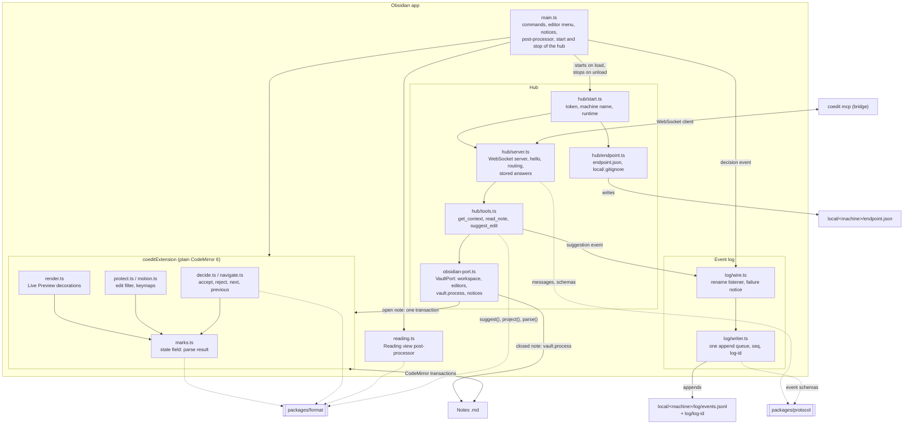
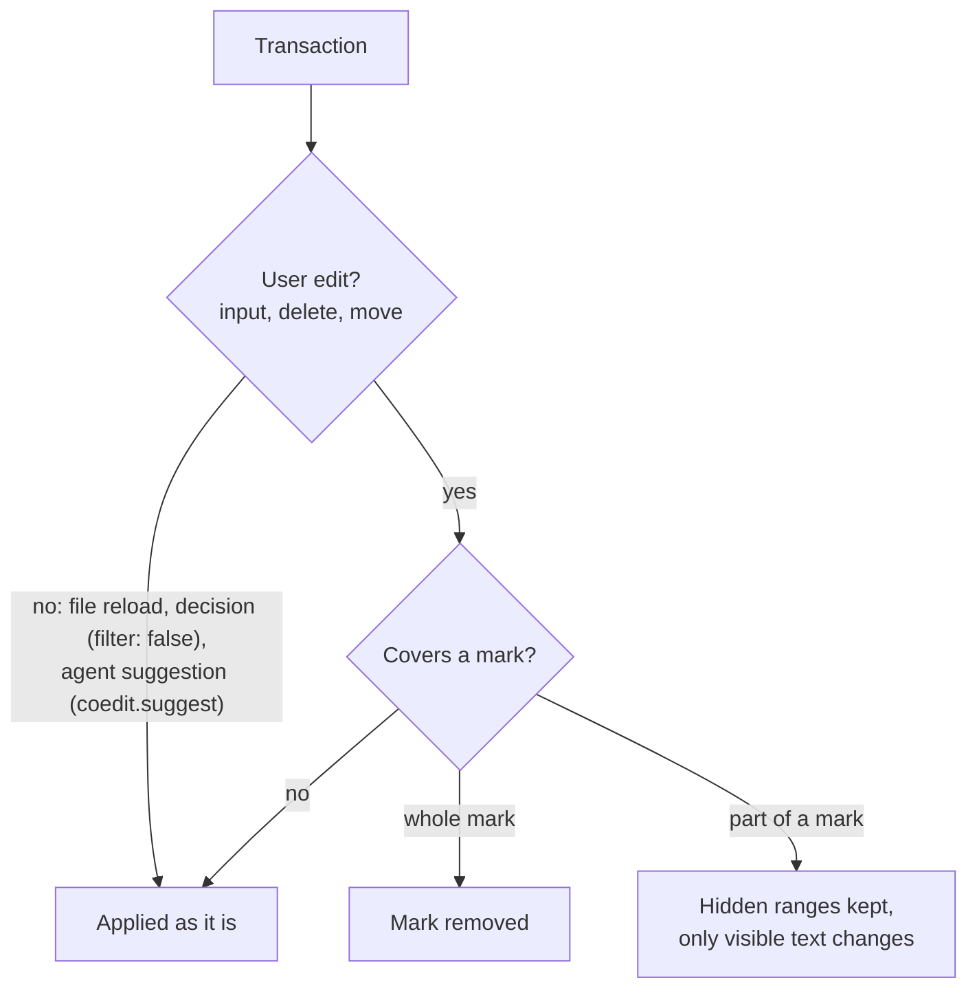
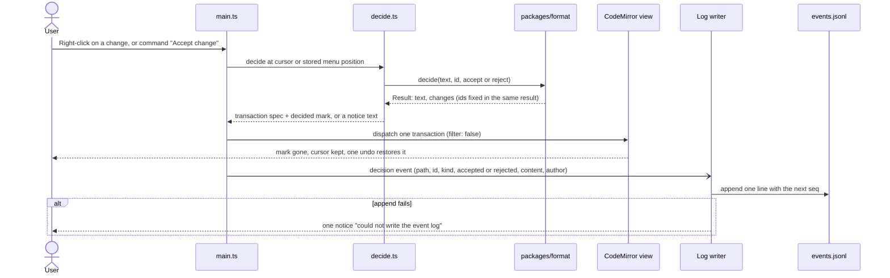
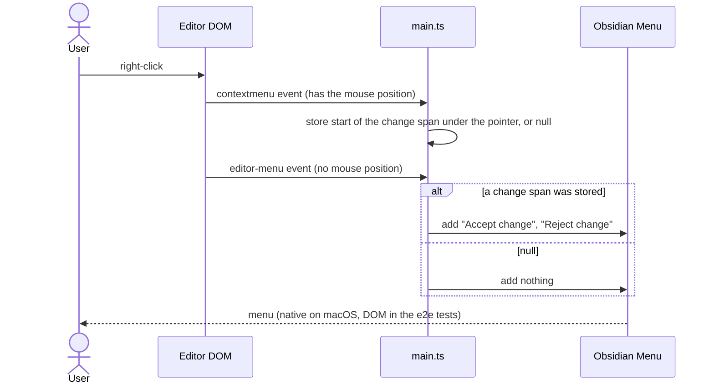
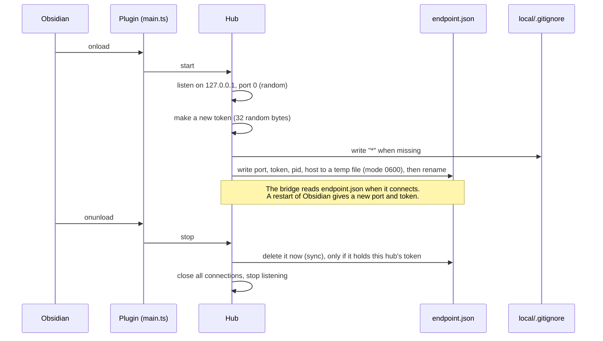
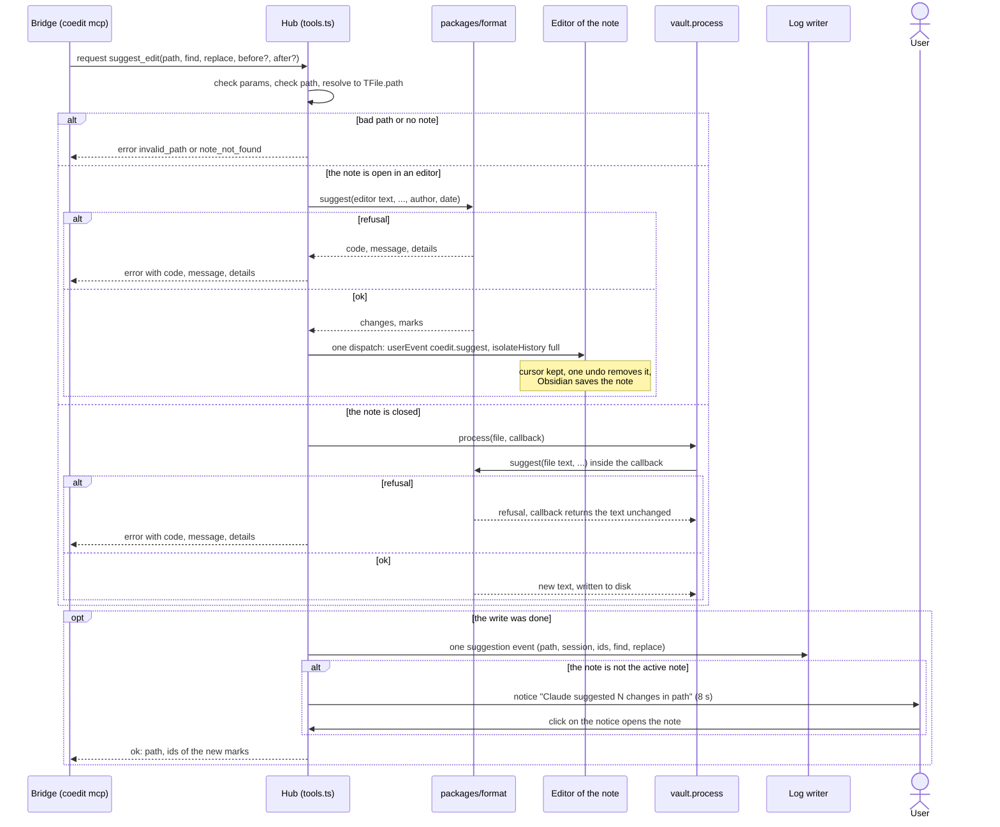

# MD-Coeditor architecture: Obsidian side

Part of the architecture. The entry point is [architecture.md](architecture.md). The Claude side is in [architecture-claude.md](architecture-claude.md), the mark format in [architecture-format.md](architecture-format.md). Build and version rules for the plugin are in [tech-stack.md](tech-stack.md#obsidian-plugin).

The Obsidian plugin (`packages/obsidian`) has two parts:

- **Editor** (change 2): renders marks and lets the user accept and reject them.
- **Hub and log writer** (change 3): the WebSocket server for the bridge, the tool logic that writes suggestions, and the event log.

## Component diagram

Solid lines: built. Dashed lines: uses a shared package.

Only `main.ts`, `hub/start.ts`, `log/wire.ts` and `obsidian-port.ts` import `obsidian`. The server, the endpoint file, the tool handlers and the log writer use Node and CodeMirror only, so vitest runs them without the app.

## Editor

From change 2 (`add-obsidian-review-basics`).

### Modules

All editor logic is plain CodeMirror 6 code in `packages/obsidian/src`, so it runs in jsdom tests. `main.ts` registers the extension, the commands, the editor menu and the Reading view post-processor, shows notices, sends decisions to the log, and starts the hub. It has no other logic.

| Module | Content |
|---|---|
| `marks.ts` | A state field with the parse result of the note (insertions, deletions, other kinds, duplicate ids). It parses the whole note on each document change. Also the injected `isLivePreview` check and the hidden ranges of a mark. |
| `render.ts` | Live Preview decorations: hidden syntax, the classes `coedit-ins` and `coedit-del` with an `aria-label` tooltip, atomic ranges. Nothing in Source mode. |
| `protect.ts`, `motion.ts` | Edit protection and cursor keys (see below). |
| `decide.ts`, `navigate.ts` | Accept and reject at the cursor or at the right-click position, next and previous change. `decide.ts` returns a transaction spec and the decided mark (id after `ensureId`, kind, content, author), or a notice text. |
| `reading.ts` | Reading view rendering. |
| `extension.ts` | All of the above as one extension: `coeditExtension({ isLivePreview })`. |

### Hidden syntax stays whole

- In Live Preview, the braces, operators and attributes of insertions and deletions are always hidden, also with the cursor inside. They are atomic ranges.
- A change filter applies to user edits only (`input`, `delete`, `move`). When an edit covers part of a mark, the filter keeps that mark's hidden ranges, so only the visible text changes. An edit that covers the whole mark removes it. File reloads, decisions and agent suggestions (`coedit.suggest`) are not user edits, so they pass.
- Keymaps (`Prec.high`) work on visible characters next to hidden syntax: Backspace and Delete delete the visible character on the other side, and Left and Right (also with Shift) move over one visible character with one key press. Without them, a key press at a mark edge does nothing that the user can see.
- A decision is one transaction with `filter: false`. A mark without an id, or with a duplicate id, gets a new id in the same transaction, so one undo gives back the exact text.

### Accept or reject a change

Each accept and reject in Obsidian writes a `decision` event, also when no agent session runs. The log is written after the dispatch. A failed append never blocks or undoes the decision: it writes to the console and shows one notice for each run of Obsidian.

### Right-click menu

Obsidian's `editor-menu` event does not give the mouse position. A `contextmenu` handler stores the start of the change span under the pointer (null when the pointer is not on a change span), and `editor-menu` adds "Accept change" and "Reject change" only for that position. A click on plain text next to a mark does not show the items. On macOS the menu is native by default, so the DOM does not show it. The end-to-end tests set `nativeMenus: false` in the fixture vault: the menu is then a DOM `.menu` on all systems, and the tests right-click, read the item titles and click an item (change 12, design D4). The plugin adds its items to Obsidian's `Menu` object in both cases, so the plugin code path is the same. The native display is Obsidian's code; one manual look at it stays in the manual list ([testing.md](testing.md)).

### Reading view

The post-processor collects the text nodes of a rendered section (not in `code`, `pre`, tables or frontmatter), joins them, and parses the joined text with `packages/format`. It adds a blank line between blocks, so no mark is found across two blocks. It then removes the hidden syntax from the text nodes and wraps the content in the same classes as in Live Preview. Formatting inside a mark stays. Reading view has no decisions.

### Speed

A key press parses the whole note. In a 1.13 MB note with 3,000 marks, this takes 12.6 ms on average, above the 8 ms target. A roadmap follow-up covers an incremental parse.

## Hub

From change 3 (`add-claude-suggest-loop`). The hub is a WebSocket server in the plugin (`ws`, bundled into `main.js`, and `node:crypto`). It is the only network server in MD-Coeditor (see [Who is the server?](architecture.md#who-is-the-server)). The plugin is desktop only. File paths come from `FileSystemAdapter.getBasePath()`.

| Module | Content |
|---|---|
| `hub/start.ts` | Makes the token and the machine name, starts the server, writes `endpoint.json`. A failed start shows one notice. Stop: delete `endpoint.json`, then close the server. |
| `hub/managed.ts` | Handles an unload that comes while the start still runs. |
| `hub/server.ts` | Listen, origin and host check, `hello` and token, protocol version, routing to the handlers, params check, stored answers for request ids. |
| `hub/endpoint.ts` | Write and delete `endpoint.json`; write `local/.gitignore`. |
| `hub/tools.ts` | `get_context`, `read_note`, `suggest_edit` against a `VaultPort` interface. Path checks, author and date, the notice text, the `suggestion` event. |
| `obsidian-port.ts` | The real `VaultPort`: `activeNote`, `activeEditor`, `openEditor(path)`, `process(path, fn)`, `read`, `resolve(path)` (the real-case `TFile.path`, or null) and `notice(text, path)`. Tests pass a fake port with a real CodeMirror `EditorView` in jsdom. |

### Security

- The server listens on `127.0.0.1` with port 0 (a random port). The bridge connects to `127.0.0.1`, never to `localhost`, because `localhost` can resolve to `::1`.
- `verifyClient` refuses every request that has an `Origin` header (also `Origin: null` and extension origins). Node's global `WebSocket` sends no `Origin`. It also refuses a `Host` header other than `127.0.0.1:<port>` or `localhost:<port>`, which blocks DNS rebinding.
- The token is 32 random bytes in hex, compared with `timingSafeEqual`. The client sends it once, in `hello`, not in each request.
- A first message that is not a valid `hello` with the right token closes the connection. Without `hello` within 5 s, the hub closes the connection. A message is at most 1 MB.

### Protocol

Every message is one JSON text message. The schemas are in `packages/protocol/src/messages.ts` (`PROTOCOL_VERSION = 1`).

| Direction | Message |
|---|---|
| bridge → hub, first | `{ type: "hello", protocol: 1, token, agent: "claude", session }` |
| hub → bridge | `{ type: "welcome", protocol: 1, features: [] }`, or `{ type: "error", code: "protocol_mismatch", message }` and close |
| bridge → hub | `{ type: "request", id, method, params }`, where `method` is `get_context`, `read_note` or `suggest_edit` |
| hub → bridge | `{ type: "response", id, ok: true, result }` or `{ type: "response", id, ok: false, error: { code, message, details? } }` |
| hub → bridge | `event`: reserved for push (change 4) |

- Before a handler runs, the hub checks `params` with the zod schema of the method. A failed check gives `invalid_params`. An unknown method gives `unknown_method` (a newer bridge). An unexpected error in a handler gives `internal_error`.
- **Repeated request ids.** The hub keeps the answer, or the running call, for the last 50 request ids of each session. The session comes from `hello`, not from the connection, because a repeat after a lost answer comes over a new connection. A repeat that comes while the first call still runs waits for the same result. So a repeated `suggest_edit` never writes twice.

### Hub start and stop

- `endpoint.json` = `{ port, token, pid, host }`, where `host` is the machine name. The rename makes sure that a reader never sees half a file. On Windows, a rename that fails with `EPERM` or `EBUSY` (sync tools, antivirus) is tried again up to 5 times.
- The delete on unload is synchronous and comes first, because Obsidian does not wait for `onunload`. It deletes only a file that holds this hub's token, so it never deletes the endpoint of a newer hub.

### A suggestion from the agent

The bridge sends each tool call to the hub. The hub uses `packages/format` and writes into the note. There is no rebase: `suggest` runs on the current text, and the hub writes in the same step.

- **Which editor.** When the note is open in more than one editor (also in popout windows), the hub uses the editor of the active leaf if it shows the note, else the editor that was focused last. Obsidian keeps the other editors in sync. When the note is open in any editor, the hub never uses `vault.process`.
- **Path checks.** A path is valid when it is relative, uses `/`, has no `\`, no drive letter, no leading `/`, no `.` or `..` segment, ends in `.md`, and resolves to a `TFile`. The checks run in the hub; the bridge only passes the path. The result and the event use the real case of `TFile.path`, not the agent's input.
- **Author and date.** The author is the display name of `hello.agent` (`claude` → `Claude`). The date is the local date of the Obsidian process.
- **Notice.** The count is the number of new marks: a replace makes 2. The text is `Claude suggested 1 change in <path>` for one mark, else `Claude suggested N changes in <path>`. There is no notice when the target is the active note.

### Active note, selection and agent view

- **Active note.** `workspace.getActiveViewOfType(MarkdownView)`. When the user is in the terminal, Obsidian keeps its active leaf, so the value stays right. When there is no active Markdown view (for example a canvas is active), the hub uses the last Markdown view that `active-leaf-change` reported, if it is still open.
- **Coordinates.** All positions that the tools give to the agent are in the agent view: lines are 1-based, columns are 0-based UTF-16 code units, and line ends are `\n` (`\r\n` becomes `\n`).
- **`get_context`.** The active note, the main selection of its editor mapped to the agent view (`{ text, start: { line, ch }, end: { line, ch } }`, null when empty), and `openMarks`, the number of pending insertions and deletions (null when there is no active note).
- **`read_note`.** The text from the editor when the note is open (also unsaved text), else from the vault. It returns `project(text)` and the pending insertions and deletions with `id`, `kind`, `author`, `content` and `line` (the view line where the mark starts).

## Event log

From change 3. One JSON Lines file for each machine: `.coedit/local/<machine>/log/events.jsonl`. The Obsidian plugin is its only writer. The bridge and the hook read it from disk, so the digest and `get_detail` work when Obsidian is closed (see [architecture-claude.md](architecture-claude.md#digest)). Git ignores it. The log is outside Obsidian's vault index (a dot folder), so the writer uses Node `fs`, not the vault API.

- **Writer.** One append queue for all events (`log/writer.ts`). `seq` rises by 1. At start, the writer reads the last valid line to get `seq`. When the file does not end with `\n` (a torn last line), it first appends `\n`. The writer checks each event with a strict zod schema before it appends.
- **Log id.** When the writer creates `events.jsonl`, it also writes `log/log-id` with a random id (16 bytes in hex). A log that is deleted while Obsidian runs starts again at `seq` 1 with a new id. Cursors store the id, so readers see the reset.
- **Envelope.** `{ v: 1, seq, ts, type, path, actor, agent?, session? }`. `ts` is local time with the time zone offset. `actor` is `user` or `agent`. The mark ids are in the bodies, not in the envelope.

| Type | Written when | Body |
|---|---|---|
| `suggestion` | After each successful `suggest_edit`: one event for each call | `ids` (all new marks), `find`, `replace`, `before?`, `after?`; `actor: agent`, `agent`, `session` from `hello` |
| `decision` | After each accept or reject in Obsidian | `id`, `kind` (`insertion` or `deletion`), `decision` (`accepted` or `rejected`), `content`, `author?`; `actor: user` |
| `rename` | A Markdown file was renamed or moved | `from` (old path); `path` is the new path |

- **Renames.** Obsidian fires one `rename` event for a renamed folder (at that moment the files below still have their old paths), then one event for each file below it. The plugin ignores the folder event and logs one `rename` for each Markdown file. Every Markdown rename is logged, so readers need no other state.
- **Mark identity.** A mark id is unique only inside one note. A copied note or a template can hold the same id. So every reader keys a mark by (note path, id), and the note path follows the `rename` events.
- **Latest event wins.** For one mark, readers use the latest event that sets its state. In this change that is the `decision` event. Change 16 (`add-mark-lifecycle-events`) adds more such event types under the same rule.
- **Not detected yet** (change 9): an undo of a decision, an undo of a suggestion, a mark deleted by hand.
