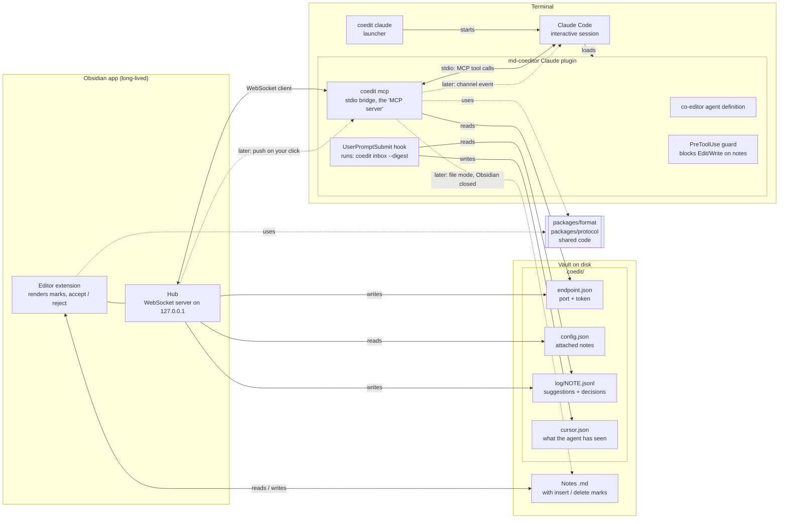

# MD-Coeditor architecture

This document shows the parts of MD-Coeditor and how they connect. It is the overview for all changes. For the order and status of the changes, see [roadmap.md](roadmap.md). The full plan is in `zany-petting-starfish.md` (outside this repo). For tools and builds, see [tech-stack.md](tech-stack.md).

Status: accepted on 2026-10-24. Slice 1 parts use solid lines. Later parts use dashed lines.

Scope: Claude Code only. Codex is deferred, because we have no access to it. Spike S3 and `adapters/codex` are not planned now. The design stays agent-neutral.

## Component diagram



## Components

| Component | Package | What it does |
|---|---|---|
| Format library | `packages/format` | Parses and writes CriticMarkup marks. Accepts and rejects marks. Pure TypeScript, no Obsidian code. |
| Protocol | `packages/protocol` | Messages between hub and bridge. Log event types. |
| Obsidian plugin | `packages/obsidian` | Renders marks. Lets the user accept and reject. Runs the hub. Writes the event log. |
| Hub | `packages/obsidian` | WebSocket server on `127.0.0.1` with a random port. Writes port and token to `endpoint.json`. It is the only network server. |
| `coedit` binary | `packages/bridge` | One binary with the subcommands `mcp`, `inbox`, `claude` and `init` (see below). |
| Claude plugin | `adapters/claude` | Packages the agent definition, the hooks, the guard and the MCP config. Contains its own copy of `coedit.mjs`. |

## Who is the server?

Obsidian is the serving side. The hub is the only network server.

The word "server" has two meanings in this project:

- **Network server.** A program that opens a port. Only the hub does this.
- **MCP server.** MCP's name for a program that offers tools. Claude Code starts it as a child process and talks to it over stdin/stdout. It opens no port and runs only while the session runs. In MD-Coeditor this is the bridge (`coedit mcp`). The bridge is a *client* of the hub.

The path for a tool call is: Claude Code ⇄ stdio ⇄ bridge ⇄ WebSocket ⇄ hub.

## Why a bridge, and not MCP over HTTP from Obsidian

Claude Code can connect to an MCP server over HTTP. So Obsidian could serve the tools itself. We do not do this, for three reasons:

1. **Push needs stdio.** A channel server must connect over stdio, and Claude Code starts it as a subprocess (see the Claude Code channels reference). Obsidian cannot be that subprocess.
2. **File mode.** When Obsidian is closed, a program must still accept `suggest_edit`. The bridge can write files. Obsidian cannot, because it does not run.
3. **Port and token change.** The bridge reads `endpoint.json` when it runs. An HTTP config needs the URL and token when Claude Code starts.

## The `coedit` binary

| Subcommand | Who runs it | What it does |
|---|---|---|
| `coedit init` | You, one time for each vault | Prepares a vault (see below). |
| `coedit claude [--doc note.md]` | You, or the Obsidian command "Start co-editor" | Finds the vault and the Claude plugin. Attaches the note. Starts `claude` with the plugin switched on for this session only. |
| `coedit inbox --digest --mark-read` | The `UserPromptSubmit` hook | Reads the log from disk, makes the digest, moves the cursor. Works when Obsidian is closed. |
| `coedit mcp` | Claude Code | The bridge. Offers the MCP tools over stdio and sends each call to the hub. |

CLI rules:

- **Exit codes.** 0 success, 1 runtime error, 2 usage error.
- **Subcommand registry.** Each subcommand has a name, a one-line description and a handler. The help text is made from the registry. A new subcommand is a new registry entry.
- **Testable entry.** `src/cli.ts` only calls `run(argv, io)`. `io` contains `stdout`, `stderr` and the version, so tests can pass fakes.

### `coedit init`

Run it inside a vault. It is idempotent: a second run updates the plugin files and changes nothing else. Other commands also work without `init`. They create missing folders themselves.

1. **Find the vault.** Look for `.obsidian/` in the current folder and in the folders above it. If there is none, stop with the error "Not inside an Obsidian vault".
2. **Install the Obsidian plugin.** If `.obsidian/plugins/md-coeditor/` is missing or older, copy the plugin files. With `--dev`, make a link to `packages/obsidian/dist` (a symlink on macOS and Linux, a directory junction on Windows). Add `md-coeditor` to `.obsidian/community-plugins.json`. If Obsidian is open, show: "Reload Obsidian. If the plugin is off, switch it on in Settings → Community plugins." Obsidian can overwrite this file while it runs.
3. **Check the Claude plugin.** Run `claude plugin list --json`.
   - Installed: show its id.
   - Not installed: show that `coedit claude` works without it (`--plugin-dir`). Show the commands to install it at user scope. Do not install it automatically. In a company, that is the user's decision.
   - Do not suggest project scope. Then every `claude` session in the vault loads the plugin.
   - `claude` not found: show a warning.
4. **Create `.coedit/`.** Write `config.json` with defaults, only if it is missing. Write `.coedit/.gitignore`.
5. **Show the next step.** For example: "Reload Obsidian, then run `coedit claude`."

`init` does not change notes, and does not change the vault's own `.gitignore`.

## Git

The note is the source of truth. Marks and comments stay inline in the note, and git commits them with the note. The review state travels with the note, like a Word file. Later we can add a warning for notes with open marks.

Everything else in `.coedit/` that belongs to this machine stays out of git. `coedit init` writes this file:

```gitignore
# .coedit/.gitignore — written by coedit init
# Local state of this machine. Do not commit.
endpoint.json
cursor.json
log/
snapshots/
*.sock
*.lock
```

| Path | In git? | Why |
|---|---|---|
| Notes with marks and comments | Yes | Source of truth. |
| `.coedit/config.json` | Yes | Attached notes and settings. |
| `.coedit/style.md` | Yes | Voice and style notes for the agent. |
| `.coedit/log/` | No | Local history of suggestions and decisions. |
| `.coedit/endpoint.json` | No | Contains the hub token. |
| `.coedit/cursor.json`, `snapshots/`, sockets, locks | No | Local state. |

## Rules

- **One writer for each file.** The hub writes the notes, the log and `endpoint.json`. The bridge and `coedit inbox` write only `cursor.json`.
- **Thin bridge in slice 1.** In slice 1 the bridge only sends tool calls to the hub. The tool logic (rebase, write marks, log) is in the hub. The bridge gets its own logic later, for file mode.
- **No hub, no tools in slice 1.** If Obsidian is closed, `suggest_edit` returns the error "Obsidian not connected".
- **Activation only through the launcher.** The Claude plugin has `defaultEnabled: false`. Only `coedit claude` switches it on, for one session, with `--settings`. Never enable it at user scope or project scope.

## Slice 1 flow

1. The user runs `coedit claude --doc note.md` and types a request.
2. Claude Code calls `suggest_edit`. The bridge sends the call to the hub.
3. The hub writes `{--old--}{++new++}` into the note and a `suggestion` event into the log.
4. The user accepts or rejects each mark in Obsidian. The hub writes a `decision` event into the log.
5. The user types the next prompt. The hook runs `coedit inbox --digest`. The digest shows the decisions to the agent and moves the cursor forward.

## Open decisions

- Spike S2: which channel flag value works for each load method. See [tech-stack.md](tech-stack.md#checks-for-the-spikes).
