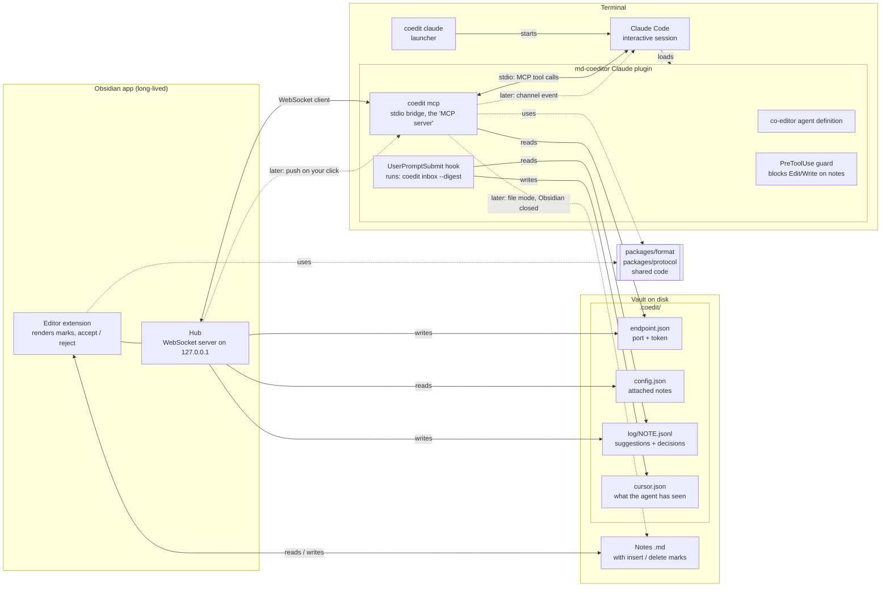

# MD-Coeditor architecture

This document shows the parts of MD-Coeditor and how they connect. It is the overview for all changes. For the order and status of the changes, see [roadmap.md](roadmap.md). For the purpose and value of the product, see [vision.md](vision.md). The frozen initial plan is [initial-plan.md](initial-plan.md). For tools and builds, see [tech-stack.md](tech-stack.md).

Status: accepted on 2026-10-24. Slice 1 parts use solid lines. Later parts use dashed lines.

Scope: Claude Code only. Codex is deferred, because we have no access to it. Spike S3 and `adapters/codex` are not planned now. The design stays agent-neutral.

## Component diagram



## Components

| Component | Package | What it does |
|---|---|---|
| Format library | `packages/format` | Parses and writes CriticMarkup marks, finds protected zones, makes suggestions, accepts and rejects marks, and gives the agent view. Pure TypeScript, no Obsidian code. See [Mark format](#mark-format). |
| Protocol | `packages/protocol` | Messages between hub and bridge. Log event types. |
| Obsidian plugin | `packages/obsidian` | Renders marks. Lets the user accept and reject. Runs the hub. Writes the event log. |
| Hub | `packages/obsidian` | WebSocket server on `127.0.0.1` with a random port. Writes port and token to `endpoint.json`. It is the only network server. |
| `coedit` binary | `packages/bridge` | One binary with the subcommands `mcp`, `inbox`, `claude` and `init` (see below). |
| Claude plugin | `adapters/claude` | Packages the agent definition, the hooks, the guard and the MCP config. Contains its own copy of `coedit.mjs`. |

## Who is the server?

Obsidian is the serving side. The hub is the only network server.

The word "server" has two meanings in this project:

- **Network server.** A program that opens a port. Only the hub does this.
- **MCP server.** MCP's name for a program that offers tools. Claude Code starts it as a child process and talks to it over stdin/stdout. It opens no port and runs only while the session runs. In MD-Coeditor this is the bridge (`coedit mcp`). The bridge is a *client* of the hub.

The path for a tool call is: Claude Code ⇄ stdio ⇄ bridge ⇄ WebSocket ⇄ hub.

## Why a bridge, and not MCP over HTTP from Obsidian

Claude Code can connect to an MCP server over HTTP. So Obsidian could serve the tools itself. We do not do this, for three reasons:

1. **Push needs stdio.** A channel server must connect over stdio, and Claude Code starts it as a subprocess (see the Claude Code channels reference). Obsidian cannot be that subprocess.
2. **File mode.** When Obsidian is closed, a program must still accept `suggest_edit`. The bridge can write files. Obsidian cannot, because it does not run.
3. **Port and token change.** The bridge reads `endpoint.json` when it runs. An HTTP config needs the URL and token when Claude Code starts.

## The `coedit` binary

| Subcommand | Who runs it | What it does |
|---|---|---|
| `coedit init` | You, one time for each vault | Prepares a vault (see below). |
| `coedit claude [--doc note.md]` | You, or the Obsidian command "Start co-editor" | Finds the vault and the Claude plugin. Attaches the note. Starts `claude` with the plugin switched on for this session only. |
| `coedit inbox --digest --mark-read` | The `UserPromptSubmit` hook | Reads the log from disk, makes the digest, moves the cursor. Works when Obsidian is closed. |
| `coedit mcp` | Claude Code | The bridge. Offers the MCP tools over stdio and sends each call to the hub. |

CLI rules:

- **Exit codes.** 0 success, 1 runtime error, 2 usage error.
- **Subcommand registry.** Each subcommand has a name, a one-line description and a handler. The help text is made from the registry. A new subcommand is a new registry entry.
- **Testable entry.** `src/cli.ts` only calls `run(argv, io)`. `io` contains `stdout`, `stderr` and the version, so tests can pass fakes.

### `coedit init`

Run it inside a vault. It is idempotent: a second run updates the plugin files and changes nothing else. Other commands also work without `init`. They create missing folders themselves.

1. **Find the vault.** Look for `.obsidian/` in the current folder and in the folders above it. If there is none, stop with the error "Not inside an Obsidian vault".
2. **Install the Obsidian plugin.** If `.obsidian/plugins/md-coeditor/` is missing or older, copy the plugin files. With `--dev`, make a link to `packages/obsidian/dist` (a symlink on macOS and Linux, a directory junction on Windows). Add `md-coeditor` to `.obsidian/community-plugins.json`. If Obsidian is open, show: "Reload Obsidian. If the plugin is off, switch it on in Settings → Community plugins." Obsidian can overwrite this file while it runs.
3. **Check the Claude plugin.** Run `claude plugin list --json`.
   - Installed: show its id.
   - Not installed: show that `coedit claude` works without it (`--plugin-dir`). Show the commands to install it at user scope. Do not install it automatically. In a company, that is the user's decision.
   - Do not suggest project scope. Then every `claude` session in the vault loads the plugin.
   - `claude` not found: show a warning.
4. **Create `.coedit/`.** Write `config.json` with defaults, only if it is missing. Write `.coedit/.gitignore`.
5. **Show the next step.** For example: "Reload Obsidian, then run `coedit claude`."

`init` does not change notes, and does not change the vault's own `.gitignore`.

## Git

The note is the source of truth. Marks and comments stay inline in the note, and git commits them with the note. The review state travels with the note, like a Word file. Later we can add a warning for notes with open marks.

Everything else in `.coedit/` that belongs to this machine stays out of git. `coedit init` writes this file:

```gitignore
# .coedit/.gitignore — written by coedit init
# Local state of this machine. Do not commit.
endpoint.json
cursor.json
log/
snapshots/
*.sock
*.lock
```

| Path | In git? | Why |
|---|---|---|
| Notes with marks and comments | Yes | Source of truth. |
| `.coedit/config.json` | Yes | Attached notes and settings. |
| `.coedit/style.md` | Yes | Voice and style notes for the agent. |
| `.coedit/log/` | No | Local history of suggestions and decisions. |
| `.coedit/endpoint.json` | No | Contains the hub token. |
| `.coedit/cursor.json`, `snapshots/`, sockets, locks | No | Local state. |

## Mark format

`packages/format` owns the mark format. Every other part (plugin, hub, bridge) uses it and does not parse marks itself. Users commit notes in this format, so later changes must stay compatible with it. The details are in the specs `markup-format` and `change-decisions`.

### Dialect

The dialect is the obsidian-track-changes format. We checked it against the other Obsidian CriticMarkup plugins on 2026-10-24.

- The five CriticMarkup kinds: `{++insertion++}`, `{--deletion--}`, `{~~old~>new~~}`, `{==highlight==}`, `{>>comment<<}`.
- An optional attribute prefix inside the braces: `{id="k3f9qz" author="Claude" date="2026-10-24"++new++}`. New marks write `id`, `author`, `date` in this order. Unknown attributes are kept, in their order. This is the extension point for later attributes.
- Attribute rules: spaces or tabs separate the attributes. A value has no `"`, `{`, `}` or line break. A `date` is a real calendar date.
- Compatibility: the obsidian-track-changes plugin reads our marks, with author and date. The plugins review-comments, review-critics, Inkling and Commentator show our marks as plain text. They do not damage the note. Commentator writes its data as `{++{"author":"X"}@@x++}`. We read that data as content for now. A follow-up in `add-external-changes` fixes this (see [roadmap.md](roadmap.md#follow-ups-from-change-1)).
- A mark ends at the first close sequence of its kind. A mark can contain a single line break, but no blank line.
- Considered and rejected: the attributes in an HTML comment after the mark (`{++x++}<!--id="a1"-->`). Plain CriticMarkup tools would show a clean mark, but an edit can separate the comment from its mark. Only `attrs.ts`, `parse.ts` and `serialize.ts` know the prefix.

### Protected zones

Frontmatter (also after a byte order mark), fenced and indented code blocks, inline code, and tables. Marks are never recognized, created or decided inside them, and a mark never crosses a block zone. The zone rules are simple approximations of CommonMark, not a full parser. Known gaps (escaped backticks, `[[wikilinks]]`, callout markers) are roadmap follow-ups.

### Ids

Each mark that MD-Coeditor creates gets a random 6-character id (`[a-z0-9]`). Ids are not counters, because the event log keeps old ids after their marks leave the note. `assignIds` gives ids to marks without one and to duplicates (for example after copy and paste). It changes only the prefix.

### Rules for the format library

- **Pure functions.** Text in, data out. No I/O, no clock, no global state. No imports from Obsidian, CodeMirror, Node or the DOM, so it runs in Electron and in Node.
- **Lossless.** Parse never normalizes. Parse and serialize give back the same text, byte for byte (CRLF, non-ASCII, malformed marks).
- **Positions are UTF-16 code units**, the same as JavaScript string indices and CodeMirror positions. Nothing may split a surrogate pair (an emoji).
- **Writers report edits.** `suggest`, `decide` and `assignIds` return `changes` (`from`, `to`, `insert`, in positions of the input text) and the new text. The plugin applies `changes` as one CodeMirror transaction, so the cursor and the undo history survive.
- **Functions take text, not a parse result.** A caller cannot pass a stale parse.
- **Refusals are results, not exceptions.** Each has a code and a short English message that the hub can give to the agent as it is. Exceptions are only for programming errors.

### Agent view

The agent view is the note as if all pending marks were accepted: insertions, highlights and the new text of substitutions show; deletions and comments are hidden. `project()` makes it, with a map back to note positions.

- The agent reads notes in the agent view (the read tool in change 3), and `suggest` matches the find text in the same view. So matches fit what the agent saw.
- Matches that touch a pending mark count. If the agent sees the text two times, the result is `ambiguous`, never a silent choice. Matches in protected zones do not count.

### Suggestions are safe in every outcome

A suggestion becomes a deletion and an insertion, each with its own id and decision. Only the changed words are marked. Before `suggest` writes, it checks the marked text and every decision outcome (accept all, reject all, and both mixed outcomes):

- No other mark is lost, joined or added, and the protected zones stay the same. Else: `unsafe_result`.
- The block structure of the line stays the same: block prefix (heading, list, task and quote markers, indentation of 4 or more columns), setext underline, thematic break. Else: `structural_edit`.

So a decision in Obsidian can never break the note or hide other pending marks. Slice 1 suggestions are one line each, with no markup in the find or replace text.

## Obsidian plugin editor

From change 2 (`add-obsidian-review-basics`).

### Modules

All editor logic is plain CodeMirror 6 code in `packages/obsidian/src`, so it runs in jsdom tests. Only `main.ts` imports `obsidian`. It registers the extension, the commands, the editor menu and the Reading view post-processor, and it shows notices. It has no other logic.

| Module | Content |
|---|---|
| `marks.ts` | A state field with the parse result of the note (insertions, deletions, other kinds, duplicate ids). It parses the whole note on each document change. Also the injected `isLivePreview` check and the hidden ranges of a mark. |
| `render.ts` | Live Preview decorations: hidden syntax, the classes `coedit-ins` and `coedit-del` with an `aria-label` tooltip, atomic ranges. Nothing in Source mode. |
| `protect.ts`, `motion.ts` | Edit protection and cursor keys (see below). |
| `decide.ts`, `navigate.ts` | Accept and reject at the cursor or at the right-click position, next and previous change. Each returns a transaction spec or a notice text. |
| `reading.ts` | Reading view rendering. |
| `extension.ts` | All of the above as one extension: `coeditExtension({ isLivePreview })`. |

### Hidden syntax stays whole

- In Live Preview, the braces, operators and attributes of insertions and deletions are always hidden, also with the cursor inside. They are atomic ranges.
- A change filter applies to user edits only (`input`, `delete`, `move`). When an edit covers part of a mark, the filter keeps that mark's hidden ranges, so only the visible text changes. An edit that covers the whole mark removes it. File reloads and decisions are not user edits, so they pass.
- Keymaps (`Prec.high`) work on visible characters next to hidden syntax: Backspace and Delete delete the visible character on the other side, and Left and Right (also with Shift) move over one visible character with one key press. Without them, a key press at a mark edge does nothing that the user can see.
- A decision is one transaction with `filter: false`. A mark without an id, or with a duplicate id, gets a new id in the same transaction, so one undo gives back the exact text.

### Right-click menu

Obsidian's `editor-menu` event does not give the mouse position. A `contextmenu` handler stores the start of the change span under the pointer (null when the pointer is not on a change span), and `editor-menu` adds "Accept change" and "Reject change" only for that position. A click on plain text next to a mark does not show the items. On macOS the menu is native, so end-to-end tests must read the menu object, not the DOM.

### Reading view

The post-processor collects the text nodes of a rendered section (not in `code`, `pre`, tables or frontmatter), joins them, and parses the joined text with `packages/format`. It adds a blank line between blocks, so no mark is found across two blocks. It then removes the hidden syntax from the text nodes and wraps the content in the same classes as in Live Preview. Formatting inside a mark stays. Reading view has no decisions.

### Speed

A key press parses the whole note. In a 1.13 MB note with 3,000 marks, this takes 12.6 ms on average, above the 8 ms target. A roadmap follow-up covers an incremental parse.

## Rules

- **One writer for each file.** The hub writes the notes, the log and `endpoint.json`. The bridge and `coedit inbox` write only `cursor.json`.
- **Thin bridge in slice 1.** In slice 1 the bridge only sends tool calls to the hub. The tool logic (rebase, write marks, log) is in the hub. The bridge gets its own logic later, for file mode.
- **One mark parser.** Only `packages/format` parses and writes marks. The plugin, the hub and the bridge call it.
- **No hub, no tools in slice 1.** If Obsidian is closed, `suggest_edit` returns the error "Obsidian not connected".
- **Activation only through the launcher.** The Claude plugin has `defaultEnabled: false`. Only `coedit claude` switches it on, for one session, with `--settings`. Never enable it at user scope or project scope.

## Slice 1 flow

1. The user runs `coedit claude --doc note.md` and types a request.
2. Claude Code calls `suggest_edit`. The bridge sends the call to the hub.
3. The hub writes `{--old--}{++new++}` into the note and a `suggestion` event into the log.
4. The user accepts or rejects each mark in Obsidian. The hub writes a `decision` event into the log.
5. The user types the next prompt. The hook runs `coedit inbox --digest`. The digest shows the decisions to the agent and moves the cursor forward.

## Open decisions

- Spike S2: which channel flag value works for each load method. See [tech-stack.md](tech-stack.md#checks-for-the-spikes).
