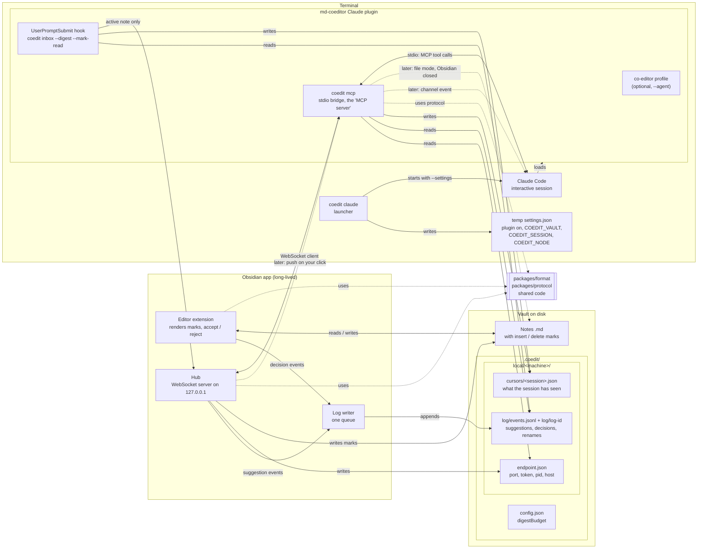
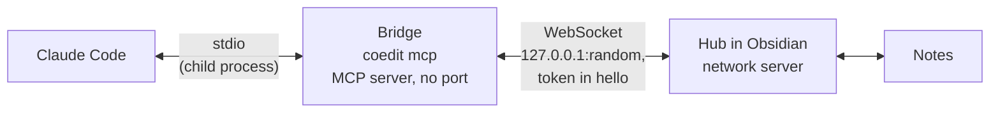
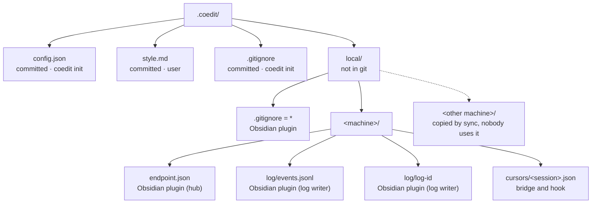
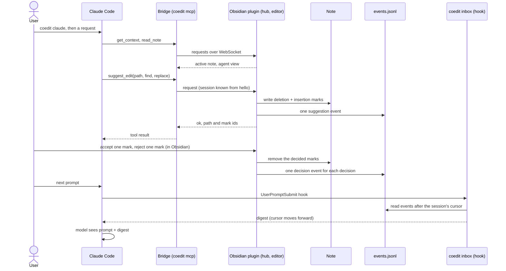

# MD-Coeditor architecture

This document shows the parts of MD-Coeditor and how they connect. It is the overview for all changes and the entry point to the architecture documents. For the order and status of the changes, see [roadmap.md](roadmap.md). For the purpose and value of the product, see [vision.md](vision.md). The frozen initial plan is [initial-plan.md](initial-plan.md). For tools and builds, see [tech-stack.md](tech-stack.md).

Status: accepted on 2026-10-24. Split into four documents on 2026-10-25. Updated on 2026-10-25 to show the built result of change 3 (`add-claude-suggest-loop`): Obsidian's active note as the agent's focus, soft protection with no guard, one event log and one folder for each machine, and a cursor for each session. Slice 1 parts use solid lines. Later parts use dashed lines.

Scope: Claude Code only. Codex is deferred, because we have no access to it. Spike S3 and `adapters/codex` are not planned now. The design stays agent-neutral: the protocol has an `agent` field, and the hub maps it to a display name.

## Documents

| Document | Content |
|---|---|
| [architecture.md](architecture.md) (this file) | Overview, components, who is the server, vault files and git, rules, compatibility, the slice 1 flow |
| [architecture-obsidian.md](architecture-obsidian.md) | Obsidian plugin: editor modules, hidden syntax, menu, Reading view, hub, writing a suggestion, notice, event log |
| [architecture-claude.md](architecture-claude.md) | `coedit` binary, `coedit init`, the launcher and the session id, tool calls, the five tools, digest and its delivery paths, cursors, soft protection, push |
| [architecture-format.md](architecture-format.md) | Mark format: dialect, protected zones, ids, library rules, refusals, agent view, safe suggestions |

## Component diagram



Details: the Obsidian side in [architecture-obsidian.md](architecture-obsidian.md#component-diagram), the Claude side in [architecture-claude.md](architecture-claude.md#component-diagram).

## Components

| Component | Package | What it does | Details |
|---|---|---|---|
| Format library | `packages/format` | Parses and writes CriticMarkup marks, finds protected zones, makes suggestions, accepts and rejects marks, and gives the agent view. Pure TypeScript, no Obsidian code. | [architecture-format.md](architecture-format.md) |
| Protocol | `packages/protocol` | zod schemas for the hub and bridge messages and for the log events, the tool error codes, the machine folder name and the paths below `.coedit/`. | [architecture-claude.md](architecture-claude.md#a-tool-call) |
| Obsidian plugin | `packages/obsidian` | Renders marks. Lets the user accept and reject. Runs the hub. Writes the event log. | [architecture-obsidian.md](architecture-obsidian.md) |
| Hub | `packages/obsidian` | WebSocket server on `127.0.0.1` with a random port. Writes port and token to `endpoint.json`. Runs the tool logic that changes notes. It is the only network server. | [architecture-obsidian.md](architecture-obsidian.md#hub) |
| `coedit` binary | `packages/bridge` | One binary with the subcommands `init`, `claude`, `inbox` and `mcp`. | [architecture-claude.md](architecture-claude.md#the-coedit-binary) |
| Claude plugin | `adapters/claude` | The MCP config, the `UserPromptSubmit` hook and the optional `co-editor` agent profile. Contains its own copy of `coedit.mjs`. | [architecture-claude.md](architecture-claude.md#claude-plugin-files) |

## Who is the server?

Obsidian is the serving side. The hub is the only network server.

The word "server" has two meanings in this project:

- **Network server.** A program that opens a port. Only the hub does this.
- **MCP server.** MCP's name for a program that offers tools. Claude Code starts it as a child process and talks to it over stdin/stdout. It opens no port and runs only while the session runs. In MD-Coeditor this is the bridge (`coedit mcp`). The bridge is a *client* of the hub. The hook (`coedit inbox`) is also a client, but it only asks for the active note.

The path for a tool call is: Claude Code ⇄ stdio ⇄ bridge ⇄ WebSocket ⇄ hub.



The hub accepts only local clients that know the token: it listens on `127.0.0.1`, refuses every request with an `Origin` header and every `Host` other than `127.0.0.1:<port>` or `localhost:<port>`, and checks the token in the first message. Node's global `WebSocket` sends no `Origin`, so the bridge passes. Details: [architecture-obsidian.md](architecture-obsidian.md#security).

## Why a bridge, and not MCP over HTTP from Obsidian

Claude Code can connect to an MCP server over HTTP. So Obsidian could serve the tools itself. We do not do this, for three reasons:

1. **Push needs stdio.** A channel server must connect over stdio, and Claude Code starts it as a subprocess (see the Claude Code channels reference). Obsidian cannot be that subprocess.
2. **File mode.** When Obsidian is closed, a program must still accept `suggest_edit`. The bridge can write files. Obsidian cannot, because it does not run.
3. **Port and token change.** The bridge reads `endpoint.json` when it connects. An HTTP config needs the URL and token when Claude Code starts.

## Vault files and git

The note is the source of truth. Marks and comments stay inline in the note, and git commits them with the note. The review state travels with the note, like a Word file. The log is only local history: if it is lost, nothing in the notes is lost. Later we can add a warning for notes with open marks.

Vaults are often synced (Dropbox, iCloud, OneDrive, Syncthing, git). So all machine-local state is in a folder for each machine, `.coedit/local/<machine>/`. Two machines never share an endpoint, a log or a cursor.



`<machine>` is `os.hostname()`: the part before the first `.`, in lower case, with each character outside `a-z0-9-` changed to `-`, or `machine` when that is empty. The plugin and the bridge compute it with the same function (`packages/protocol/src/paths.ts`). Two machines with the same name share a folder again; give them different names.

`coedit init` writes `.coedit/.gitignore`. On a later run it adds the lines that are missing and keeps the user's own lines:

```gitignore
local/
snapshots/
*.sock
*.lock
```

The Obsidian plugin also writes `.coedit/local/.gitignore` with the line `*` when it is missing. So git ignores the machine folders also when `coedit init` never ran.

| Path | In git? | Why | Writer |
|---|---|---|---|
| Notes with marks and comments | Yes | Source of truth. | Obsidian plugin (hub: agent suggestions; editor: user decisions and edits) |
| `.coedit/config.json` | Yes | Settings. Now only `digestBudget`. | `coedit init` (only when missing), then the user |
| `.coedit/style.md` | Yes | Voice and style notes for the agent. | User |
| `.coedit/.gitignore` | Yes | Keeps local state out of git. | `coedit init` |
| `.coedit/local/.gitignore` | No | `*`: ignore the whole folder. | Obsidian plugin |
| `.coedit/local/<machine>/endpoint.json` | No | Port, token, pid and machine name of the hub. | Obsidian plugin (hub) |
| `.coedit/local/<machine>/log/` | No | Local history of suggestions, decisions and renames. | Obsidian plugin (log writer) |
| `.coedit/local/<machine>/cursors/` | No | One cursor for each session. | Bridge (`coedit mcp`) and hook (`coedit inbox`) |

## Rules

- **One writer for each file.** The Obsidian plugin writes the notes, the log, `endpoint.json` and `local/.gitignore`. The bridge and `coedit inbox` write only the cursor files. `coedit init` writes `config.json`, `.coedit/.gitignore` and the Obsidian plugin files.
- **Tool logic that changes notes is in the hub.** The hub reads the note in the agent view, writes the marks and logs the suggestion. There is no rebase in slice 1: the hub runs `suggest` on the current text and writes in the same step. The bridge has its own logic only for reading: it reads the log, builds the digest and writes the cursors.
- **One mark parser.** Only `packages/format` parses and writes marks. The plugin and the hub call it.
- **Obsidian closed.** `read_note` and `suggest_edit` return the error `hub_unavailable` ("Obsidian not connected"). `get_context` returns `hubConnected: false`. `get_detail`, `get_digest` and the hook only read files, so they work without Obsidian. File mode comes in change 8.
- **Activation only through the launcher.** The Claude plugin has `defaultEnabled: false`. Only `coedit claude` switches it on, for one session, with a settings file passed to `--settings`. Never enable it at user scope or project scope.
- **Soft protection.** "Suggest only" is a rule for the agent, carried by the tool descriptions, the server instructions and the optional profile. There is no guard. Hard blocks come from the project's Claude Code permissions (`coedit init` shows a deny rule) and from the Claude Code sandbox. Deny rules do not stop scripts that the agent runs. Details: [architecture-claude.md](architecture-claude.md#soft-protection).
- **Every agent interaction is started by the user.** In slice 1 the agent learns about decisions only with the next prompt, or when it calls `get_digest`.

## Compatibility

The Obsidian plugin (copied by `coedit init`) and the Claude plugin (marketplace) update apart, so a version mismatch is normal. Later changes can add messages, event types and tool options without a breaking change:

- Each log event has `v: 1`. Readers skip events with an unknown `type` and ignore unknown fields (`passthrough` zod objects, no closed enum for `kind` in the reader).
- The hub and the bridge ignore unknown fields in messages. The bridge ignores unknown message types. The message type `event` is reserved for push (change 4). `welcome.features` lists optional abilities; it is empty now.
- A `hello` with another `protocol` number gets the message `protocol_mismatch` and the hub closes the connection. The tool error then says to update the Obsidian plugin or `coedit`. It does not say "Obsidian not connected".
- The hub is the only log writer now. Change 8 (file mode) adds a second writer. It must then append under the lock file `log/events.lock`.

## Slice 1 flow

1. The user runs `coedit claude` in a folder at or above the vault and types a request.
2. Claude Code calls `get_context` and `read_note`, then `suggest_edit`. The bridge sends each call to the hub.
3. The hub writes `{--old--}{++new++}` into the note (through the editor when the note is open, else with `vault.process`) and one `suggestion` event into the log. When the note is not the active note, a notice tells the user.
4. The user accepts or rejects each mark in Obsidian. The plugin writes one `decision` event for each decision.
5. The user types the next prompt. The hook runs `coedit inbox --digest --mark-read`. The digest shows the decisions to the agent and moves the session's cursor forward.



Each step in detail: [session start](architecture-claude.md#session-start), [a tool call](architecture-claude.md#a-tool-call), [the hub writes a suggestion](architecture-obsidian.md#a-suggestion-from-the-agent), [accept or reject](architecture-obsidian.md#accept-or-reject-a-change), [digest](architecture-claude.md#digest).

## Open decisions

- Spike S2: which channel flag value works for each load method. See [tech-stack.md](tech-stack.md#checks-for-the-spikes).
- A stable machine name: on macOS, `os.hostname()` can change with the network, and then the plugin and the bridge use two machine folders until Obsidian restarts. Follow-up in the roadmap.
- Windows is not tested yet. The open checks are in [windows-check-list.md](windows-check-list.md).
