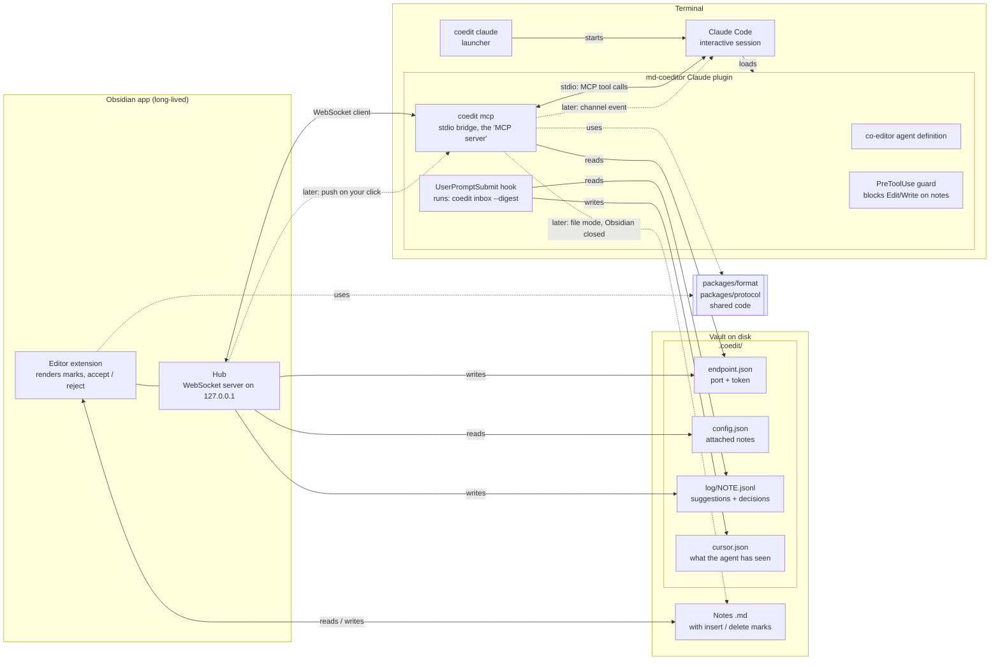
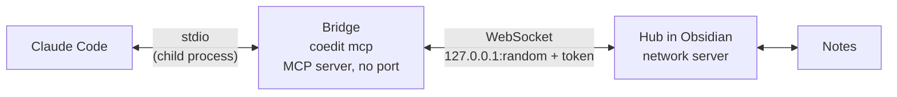
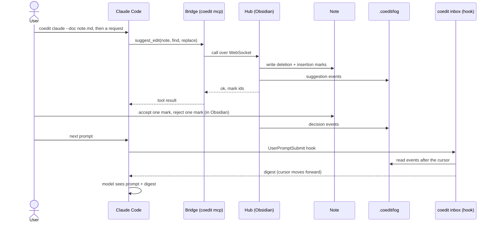

# MD-Coeditor architecture

> **Note (2026-10-25):** This file still shows the plan before change 3 (`add-claude-suggest-loop`). Change 3 drops note attachment and the guard, uses one event log for each machine, a folder for each machine (`.coedit/local/<machine>/`) and a cursor for each session. Until task 11.2 of that change updates this file, its [design.md](../changes/add-claude-suggest-loop/design.md) wins on conflict.

This document shows the parts of MD-Coeditor and how they connect. It is the overview for all changes and the entry point to the architecture documents. For the order and status of the changes, see [roadmap.md](roadmap.md). For the purpose and value of the product, see [vision.md](vision.md). The frozen initial plan is [initial-plan.md](initial-plan.md). For tools and builds, see [tech-stack.md](tech-stack.md).

Status: accepted on 2026-10-24. Split into four documents on 2026-10-25, with no design change. Slice 1 parts use solid lines. Later parts use dashed lines.

Scope: Claude Code only. Codex is deferred, because we have no access to it. Spike S3 and `adapters/codex` are not planned now. The design stays agent-neutral.

## Documents

| Document | Content |
|---|---|
| [architecture.md](architecture.md) (this file) | Overview, components, who is the server, vault files and git, rules, the slice 1 flow |
| [architecture-obsidian.md](architecture-obsidian.md) | Obsidian plugin: editor modules, hidden syntax, menu, Reading view, hub, event log |
| [architecture-claude.md](architecture-claude.md) | `coedit` binary, `coedit init`, session start, tool calls, digest, guard, push |
| [architecture-format.md](architecture-format.md) | Mark format: dialect, protected zones, ids, library rules, agent view, safe suggestions |

## Component diagram



Details: the Obsidian side in [architecture-obsidian.md](architecture-obsidian.md#component-diagram), the Claude side in [architecture-claude.md](architecture-claude.md#component-diagram).

## Components

| Component | Package | What it does | Details |
|---|---|---|---|
| Format library | `packages/format` | Parses and writes CriticMarkup marks, finds protected zones, makes suggestions, accepts and rejects marks, and gives the agent view. Pure TypeScript, no Obsidian code. | [architecture-format.md](architecture-format.md) |
| Protocol | `packages/protocol` | Messages between hub and bridge. Log event types. | |
| Obsidian plugin | `packages/obsidian` | Renders marks. Lets the user accept and reject. Runs the hub. Writes the event log. | [architecture-obsidian.md](architecture-obsidian.md) |
| Hub | `packages/obsidian` | WebSocket server on `127.0.0.1` with a random port. Writes port and token to `endpoint.json`. It is the only network server. | [architecture-obsidian.md](architecture-obsidian.md#hub) |
| `coedit` binary | `packages/bridge` | One binary with the subcommands `mcp`, `inbox`, `claude` and `init`. | [architecture-claude.md](architecture-claude.md#the-coedit-binary) |
| Claude plugin | `adapters/claude` | Packages the agent definition, the hooks, the guard and the MCP config. Contains its own copy of `coedit.mjs`. | [architecture-claude.md](architecture-claude.md) |

## Who is the server?

Obsidian is the serving side. The hub is the only network server.

The word "server" has two meanings in this project:

- **Network server.** A program that opens a port. Only the hub does this.
- **MCP server.** MCP's name for a program that offers tools. Claude Code starts it as a child process and talks to it over stdin/stdout. It opens no port and runs only while the session runs. In MD-Coeditor this is the bridge (`coedit mcp`). The bridge is a *client* of the hub.

The path for a tool call is: Claude Code ⇄ stdio ⇄ bridge ⇄ WebSocket ⇄ hub.



## Why a bridge, and not MCP over HTTP from Obsidian

Claude Code can connect to an MCP server over HTTP. So Obsidian could serve the tools itself. We do not do this, for three reasons:

1. **Push needs stdio.** A channel server must connect over stdio, and Claude Code starts it as a subprocess (see the Claude Code channels reference). Obsidian cannot be that subprocess.
2. **File mode.** When Obsidian is closed, a program must still accept `suggest_edit`. The bridge can write files. Obsidian cannot, because it does not run.
3. **Port and token change.** The bridge reads `endpoint.json` when it runs. An HTTP config needs the URL and token when Claude Code starts.

## Vault files and git

The note is the source of truth. Marks and comments stay inline in the note, and git commits them with the note. The review state travels with the note, like a Word file. Later we can add a warning for notes with open marks.

Everything else in `.coedit/` that belongs to this machine stays out of git. `coedit init` writes this file:

```gitignore
# .coedit/.gitignore — written by coedit init
# Local state of this machine. Do not commit.
endpoint.json
cursor.json
log/
snapshots/
*.sock
*.lock
```

| Path | In git? | Why | Writer |
|---|---|---|---|
| Notes with marks and comments | Yes | Source of truth. | Obsidian plugin (hub: agent suggestions; editor: user decisions and edits) |
| `.coedit/config.json` | Yes | Settings (digest budget). | `coedit init` |
| `.coedit/style.md` | Yes | Voice and style notes for the agent. | User |
| `.coedit/log/` | No | Local history of suggestions and decisions. | Hub |
| `.coedit/endpoint.json` | No | Contains the hub token. | Hub |
| `.coedit/cursor.json`, `snapshots/`, sockets, locks | No | Local state. | `coedit inbox`, bridge |

## Rules

- **One writer for each file.** The hub writes the notes, the log and `endpoint.json`. The bridge and `coedit inbox` write only `cursor.json`.
- **Thin bridge in slice 1.** In slice 1 the bridge only sends tool calls to the hub. The tool logic (rebase, write marks, log) is in the hub. The bridge gets its own logic later, for file mode.
- **One mark parser.** Only `packages/format` parses and writes marks. The plugin, the hub and the bridge call it.
- **No hub, no tools in slice 1.** If Obsidian is closed, `suggest_edit` returns the error "Obsidian not connected".
- **Activation only through the launcher.** The Claude plugin has `defaultEnabled: false`. Only `coedit claude` switches it on, for one session, with `--settings`. Never enable it at user scope or project scope.

## Slice 1 flow

1. The user runs `coedit claude --doc note.md` and types a request.
2. Claude Code calls `suggest_edit`. The bridge sends the call to the hub.
3. The hub writes `{--old--}{++new++}` into the note and a `suggestion` event into the log.
4. The user accepts or rejects each mark in Obsidian. The hub writes a `decision` event into the log.
5. The user types the next prompt. The hook runs `coedit inbox --digest`. The digest shows the decisions to the agent and moves the cursor forward.



Each step in detail: [session start](architecture-claude.md#session-start), [a tool call](architecture-claude.md#a-tool-call), [the hub writes a suggestion](architecture-obsidian.md#a-suggestion-from-the-agent), [accept or reject](architecture-obsidian.md#accept-or-reject-a-change), [digest](architecture-claude.md#digest).

## Open decisions

- Spike S2: which channel flag value works for each load method. See [tech-stack.md](tech-stack.md#checks-for-the-spikes).
